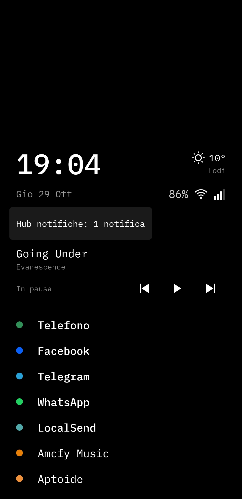
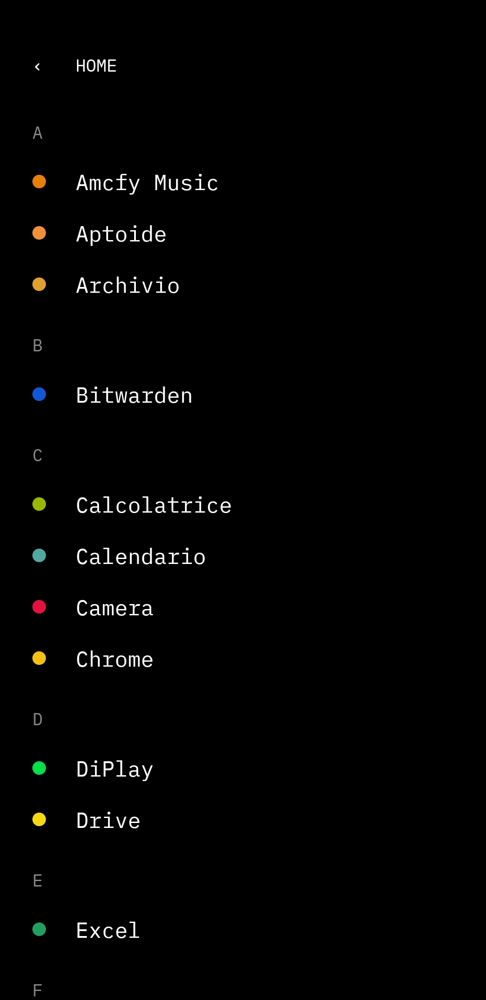
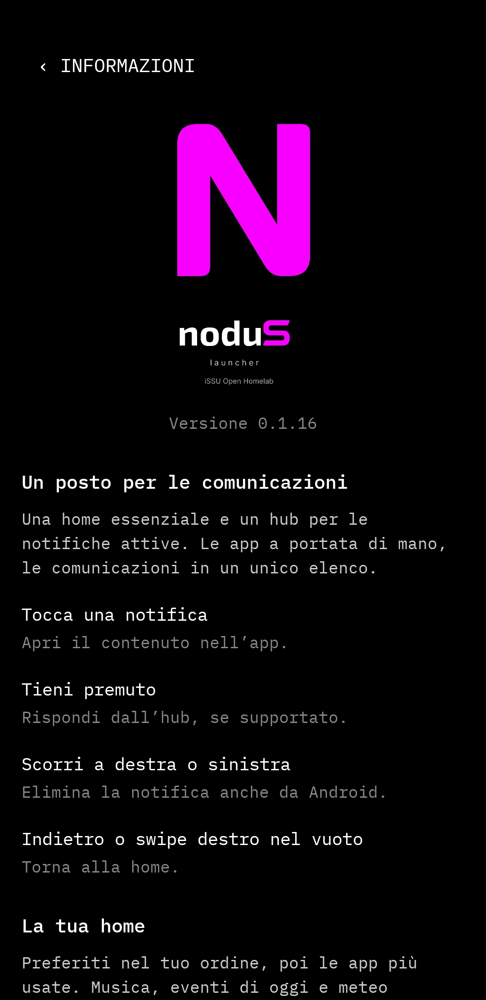

[](LICENSE)

A minimal Android launcher built around a notification hub.

noduS combines a quiet home screen with a dedicated place to read, open, reply
to and dismiss notifications. It is a personal iSSU Open Homelab project,
inspired by simple launchers and the BlackBerry communications hub.

## Project status

| Field | Current state |
|---|---|
| Maturity | Experimental |
| Used on a phone | Initial trials; 0.1.22 device checks pending |
| Recommended for everyday use | Not yet |
| Setup difficulty | APK installation and manual permissions |
| Documentation | In progress |
| Current source version | 0.1.22 — experimental GitHub beta |
| Local checks | 77 Kotlin checks; debug build and Android Lint pass |

> [!WARNING]
> This project is experimental and intended for development and testing.
> Local checks do not establish reliability on a phone. Device testing is still
> incomplete; everyday use is not recommended yet.

## Why it exists

The notification hub is the main part of noduS. The home screen keeps app access
simple, while messages and other notifications have their own scrollable page.
Android remains the source of truth: a dismissed notification does not become
an item in a separate noduS inbox.

## Features

- Full-screen notification hub, newest first, with expandable text and a fixed
  header for navigation and clearing dismissible notifications.
- Direct replies when the originating app supports them; a successful handoff
  removes the notification. Failed replies keep the draft.
- Ordered favorites, a configurable number of home apps and remaining slots
  filled from app openings over the last seven days.
- Optional clock, date, battery percentage, cellular/Wi-Fi icons and location-based weather.
- Fixed home screen with an app panel that follows an upward drag, settles on release
  and slides down on return; pull down past the first apps to close the panel.
  Android gesture edges remain reserved.
- Adjustable app/widget spacing with a live preview and shared home/hub leading edge, including app dots/icons.
- Swipe music or calendar widgets sideways to hide them temporarily.
- A setting to show or hide the system status bar throughout noduS.
- Settings, dialogs and welcome/About follow the Android language: Italian and
  English, with English as the fallback (since 0.1.21). Other home/hub commands
  still use Italian labels; full interface localization is not complete.
- Separate sizes for clock, date, weather, battery and signal/Wi-Fi icons, with
  a super compact header preset (clock above; date, weather, signal/Wi-Fi and
  battery on one left-aligned line), live preview and reset (since 0.1.20).
- Separate music and today's calendar widgets, with independent display choices.
- Dots or original app icons, adjustable text sizes, built-in/system fonts or
  an imported TTF/OTF font, and vertical positioning of the whole home block.
- A shared welcome and About screen with the approved lowercase n identity,
  magenta nodu and a white/black historic S matching the background.

### Hub controls

| Action | Result |
|---|---|
| Tap a notification | Open its target, such as the specific conversation |
| Hold a notification | Reply in the hub, if supported |
| Swipe a notification left or right | Dismiss that notification in Android |
| Swipe right on empty space | Return to the home screen |
| Back button or system Back | Return to the home screen |
| Clear all | Confirm, then dismiss all dismissible notifications |

Non-dismissible notifications remain visible. Opening the hub does not mark
messages as read. Sending a reply to an app does not confirm delivery to its
recipient. The home screen shows only the hub count, including the empty state.

## How it works

The app uses Kotlin and Jetpack Compose. Android's notification listener supplies
the hub's current contents and actions; DataStore keeps preferences. Usage
events supply app suggestions, media sessions supply music controls, and the
calendar provider supplies today's events. Weather uses Open-Meteo.

Implementation details are in the [development guide](docs/DEVELOPMENT.md).

## Screenshots

Real phone screenshots supplied during testing, captured on version **0.1.16**.
The current beta is 0.1.22; these images illustrate the appearance, rather than
confirming the latest gesture fixes or the current lowercase n branding. Tap an image to view it at full size.

| Home | All apps | About |
|:---:|:---:|:---:|
| <a href="assets/screenshots/home-0.1.16.jpg"></a> | <a href="assets/screenshots/app-drawer-0.1.16.jpg"></a> | <a href="assets/screenshots/about-0.1.16.jpg"></a> |

## Beta testing and downloads

[Download noduS 0.1.22 beta](https://github.com/issu-lab/nodus/releases/download/v0.1.22-beta.1/nodus-0.1.22-beta.zip)

Extract the ZIP and open the included APK on your phone. The package includes
installation notes and full font license copies. It updates existing test
installations using the same signing certificate; no uninstall is needed.

See [all versions and release notes](https://github.com/issu-lab/nodus/releases)
for later betas and checksums. These are experimental debug-signed builds.

See the [beta testing guide](docs/BETA_TESTING.md) for installation, permissions,
updates, useful checks and the feedback format. Older devices running Android
8.0 or newer are welcome. Participation here is separate from any future Play test.

## Build and install

Requirements: JDK 17, Android SDK Platform 34 and Android SDK Build-Tools 34.0.0.
Configure the SDK in Android Studio or through `ANDROID_HOME`.
From the project directory, on Linux or macOS:

```sh
./gradlew :app:assembleDebug
```

Install `app/build/outputs/apk/debug/app-debug.apk` on an Android 8.0 or newer
device. For example, with Android Platform Tools and an authorized device:

```sh
adb install -r app/build/outputs/apk/debug/app-debug.apk
```

Select **noduS launcher** as the default Home app in Android settings. Enable
notification access to use the hub. This produces a debug build; downloadable betas are linked above. See the [development guide](docs/DEVELOPMENT.md)
for validation commands and current build limitations.

## Configuration and usage

Hold the clock or an empty area of the home screen to open settings.
Swipe up inside home to open all apps, starting away from the screen edges.
The app panel is prepared while home is idle and follows your finger. A short slow drag returns to home; a long
drag or deliberate upward fling completes opening. Back or HOME slides it down.
The home does not scroll: it moves up as content grows and fits proportionally
only if it exceeds the available height. All apps and the hub remain scrollable.
System Back or the Home button inside the app list returns to home. Android
navigation gestures remain enabled.
Settings are grouped into Home, Notification hub, Appearance and About.
The current interface is in Italian.

| Setting or access | Purpose |
|---|---|
| Home app limit and favorites | Favorites come first in your chosen order; exceeding the limit shows a warning |
| Usage access, optional | Fill remaining slots by app openings; alphabetical fallback without access |
| Notification access | Show the hub and use notification actions and media sessions |
| Music and calendar destinations | Home, hub, both or hidden, independently for each category |
| Calendar permission | Read selected calendars for widgets on home or hub; reminders remain Android notifications |
| Approximate location, optional | Weather beside the clock, as a monochrome icon and temperature or text |
| Appearance | Dots/app icons, dot size/color, shared font and separate home/hub text sizes |
| Vertical home position | Move the fixed block within the available space |
| Row and widget spacing | Adjust gaps from 0 to 32 dp with a live preview; default 20 |
| Hide status bar | Apply across home, hub, settings and welcome; off by default |

Music appears during playback. A paused session is shown only while its player
has an active media notification; a residual resumable session alone is hidden.
Removing an app from Recents may leave its playback service and notification alive.
Title and artist have separate, single-line fields; controls occupy their own row
and unavailable player actions are disabled.
The calendar widget shows today's unfinished events, including all-day events,
and disappears when empty. Hiding either category in noduS does not dismiss its
Android notifications. Initially, music is set to home and calendar to hub.

Music and today’s events also appear as separate widgets above the hub notification
list when their destination includes hub. Calendar events require permission there
as well; without it, the hub offers an authorization button.

Swipe either widget left or right on its current screen to hide it. This does not stop playback,
delete calendar events or dismiss Android notifications. Music can return on a
new track/session or a detected playback resume; calendar returns for new events
or a new day. Dismissal is temporary state for that screen, not a display destination.

Weather starts disabled. When enabled, rounded coordinates are sent over HTTPS
to [Open-Meteo](https://open-meteo.com/en/docs); location updates run only while
the home screen is visible. Stale or unavailable weather is identified.
Imported fonts are copied into private app storage; the original file is unchanged.

## Limitations

- Initial phone trials provided appearance and interaction feedback.
  The 0.1.22 changes and full gesture/permission/app integration checks remain
  to be tested on the phone.
- Reply and conversation opening depend on actions supplied by the originating app.
- The hub filters group summaries and ongoing notifications outside configured
  music/calendar categories; it is not a complete notification archive.
- Icon packs, third-party widgets and folders are outside this prototype's scope.
- Store distribution and release signing have not been prepared.

## Documentation

- [Detailed behavior and approved identity](docs/BEHAVIOR.md) — Italian reference.
- [Development, artwork and publication preparation](docs/DEVELOPMENT.md).
- [Roadmap](docs/ROADMAP.md) — approved work and remaining device checks.
- [Changelog](docs/CHANGELOG.md) — locally verified changes and their limits.
- [Third-party notices](THIRD_PARTY_NOTICES.md).
- [Beta testing and feedback](docs/BETA_TESTING.md).

## License

Project code is available under the [MIT License](LICENSE).
Bundled fonts retain their original licenses; see the
[third-party notices](THIRD_PARTY_NOTICES.md).

---

<div align="center">

<p>This project is part of the <strong>iSSU Open Homelab ecosystem</strong>.</p>

<a href="https://github.com/issu-lab/Open-Homelab">
  
</a>

</div>
