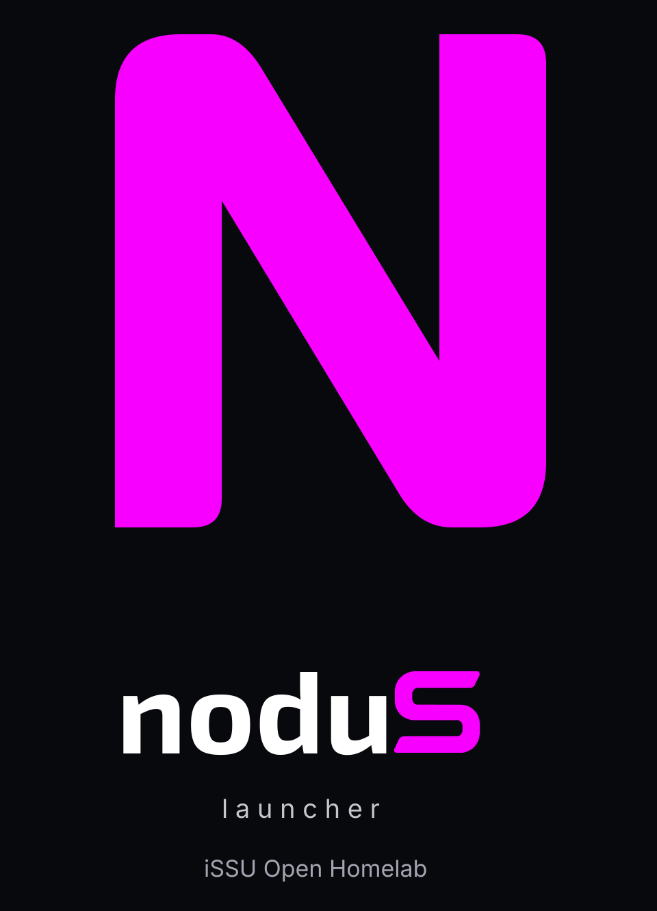

# Specifiche di comportamento noduS

Riferimento dettagliato delle decisioni approvate, conservato in italiano.
La presentazione e lo stato corrente sono nel [README](../README.md); le prove
sul telefono ancora necessarie sono nella [roadmap](ROADMAP.md).
Queste specifiche descrivono il comportamento implementato nei sorgenti,
non una certificazione di funzionamento sul dispositivo.

## Identità visiva approvata

- Simbolo: **n minuscola con raccordi rifiniti**, approvata il 30 ottobre 2026,
  morbida e senza tagli.
- Accento specifico di noduS: **magenta `#F800FF`**, piatto, senza bagliori.
  Non sostituisce il violetto ufficiale iSSU `#D94DFF` negli asset condivisi.
- Scritta: **noduS**, con **nodu magenta** e **S storica iSSU bianca su fondo scuro,
  nera su fondo chiaro**, mantenendo la distanza approvata tra u e S.
  `launcher` è su una riga separata; sotto compare **iSSU Open Homelab**.
- L'icona dell'app usa solo la n minuscola. Benvenuto e informazioni usano la composizione
  completa; il carattere del marchio resta fisso quando cambia il font della UI.
- Fondo dell'interfaccia nero pieno; la barra di stato può essere nascosta con
  uno switch nelle impostazioni Home, inizialmente disattivato. IBM Plex Mono
  resta il font iniziale della UI.

I sorgenti vettoriali sono [simbolo N](../assets/branding/source/nodus-icon.svg) e
[logo completo](../assets/branding/source/nodus-logo.svg). I PNG sono
[simbolo trasparente](../assets/branding/nodus-icon.png),
[logo trasparente](../assets/branding/nodus-logo.png) e
[presentazione su fondo scuro](../assets/branding/nodus-logo-dark.png).

La N riprende la geometria della proposta 03 originale; la spaziatura della S
riprende la successiva correzione approvata. Il nome usa Exo 2 Bold con la S dal
master `approved/issu-wordmark.svg` del progetto branding iSSU; i testi di supporto
usano Inter. Tutti i testi SVG sono tracciati, senza dipendenze da font installati.
Gli asset iSSU originali e il font storico limitato a i/S/U restano invariati.
Il logo completo è integrato come risorsa raster con geometria e tipografia
immutate. Il simbolo N è convertito in VectorDrawable per l'icona adattiva,
con fondo nero e variante monocromatica per Android 13 e successivi.

## Hub: comportamento concordato

### Schermata e contenuto

- Sulla home compare soltanto l'indicatore dell'hub con conteggio e testo,
  senza anteprime inline. A zero resta **«Hub notifiche: nessuna notifica»**,
  sempre toccabile. L'hub si apre anche con swipe a sinistra dalla home.
- L'hub occupa una schermata dedicata a tutto schermo, con elenco scorrevole;
  Indietro e «Cancella tutte» restano fissi in alto.
- Mostra le notifiche attive di Android, senza archivio indipendente né uno
  stato proprio di messaggi non letti. Aprirlo non segna tutto come letto.
- La lista è unica e cronologica, con le più recenti in alto e l'app di
  provenienza riconoscibile su ogni voce, senza gruppi per app.
- Ogni notifica Android corrisponde a una voce: gli aggiornamenti della stessa
  notifica aggiornano la voce esistente, senza duplicarla o separarne i messaggi.
- Quando c'è spazio viene mostrato il testo completo disponibile. Quando le
  notifiche aumentano si mostra la parte iniziale, espandibile con **«Mostra
  tutto»**; non si generano riassunti automatici. La disposizione resta stabile
  durante la lettura, senza richiudere improvvisamente il contenuto.
- Le nuove notifiche si inseriscono in cima senza spostare la posizione che
  l'utente sta leggendo. Se è più in basso, **«Nuove notifiche»** permette di
  tornare in cima.

### Apertura, risposta e rimozione

- **Tap:** apre il contenuto specifico previsto dalla notifica nell'app di
  origine, per esempio la conversazione corrispondente.
- **Pressione prolungata:** permette di rispondere direttamente nell'hub quando
  supportato. Altrimenti mostra **«Risposta dall'hub non disponibile»**, senza
  aprire l'app automaticamente.
- Dopo l'invio riuscito all'app, la notifica viene eliminata anche da Android.
  Questo esito non equivale a una conferma di consegna al destinatario.
- Se l'invio restituisce un errore, la notifica rimane e il testo viene conservato.
- Se la notifica scompare durante la scrittura, la voce esce dall'elenco ma il
  testo resta disponibile con un avviso; l'invio viene disabilitato.
- **Swipe sulla notifica, a destra o sinistra:** elimina soltanto quella notifica
  dall'hub e da Android. Non attiva mai la navigazione, anche se termina nel vuoto.
- **Swipe verso destra su un'area vuota:** torna alla home. Anche il pulsante
  Indietro dell'hub e Indietro di Android tornano alla home.
- Una notifica rimossa dalla tendina o dall'app scompare anche dall'hub: noduS
  non la conserva o ripropone.
- **«Cancella tutte»**, in alto, chiede **«Eliminare tutte le notifiche?»** e
  rimuove tutte le notifiche eliminabili dall'hub e da Android. Quelle non
  eliminabili restano; il comando non rimuove i widget sulla home.

## Home: app visibili e preferiti

L'utente sceglie nelle impostazioni il numero massimo di app visibili. I preferiti
hanno precedenza e sono ordinabili manualmente trascinandoli in una schermata
dedicata delle impostazioni. La home rispetta tale ordine.

I posti restanti sono occupati dalle app con **più aperture negli ultimi 7 giorni**,
con selezione aggiornata **una volta al giorno**, escludendo quelle già preferite.
Non si usa il tempo trascorso nell'app come criterio. Senza accesso ai dati di
utilizzo, i posti liberi vengono completati in ordine alfabetico, sempre senza
duplicare i preferiti. Il resto delle app è accessibile dall'elenco completo con uno swipe verso
l’alto nella home; il tasto «Tutte le app» è rimosso. Il gesto deve partire
lontano dai bordi, fuori dalle aree riservate ad Android. La home è fissa e non scorre: il gesto apre direttamente tutte le app,
anche quando sono presenti molti elementi. Il pannello delle app sale dal basso
seguendo il dito, mentre la home resta ferma sotto. La prima pagina dell’elenco
è preparata dietro la home prima del gesto, senza intercettarne i tocchi o
l’accessibilità; il ripristino della lista avviene alla chiusura, non nel primo
movimento. Il completamento usa uno smorzamento più morbido. Al rilascio completa
l’apertura in base a distanza e velocità oppure scende se il gesto è troppo corto;
un’inversione decisa verso il basso annulla l’apertura. Gesti interrotti o
multitocco fanno rientrare il pannello senza aprire app o attivare widget.
Indietro e HOME chiudono il pannello verso il basso anche durante una transizione.
Il pannello chiuso non intercetta tocchi; quello visibile copre gli elementi
sottostanti per evitare aperture involontarie. L’elenco
completo mantiene lo scorrimento normale; Indietro o «HOME» tornano alla home.
Nel cassetto, lo scorrimento verso il basso riporta prima l’elenco all’inizio.
Continuando il trascinamento oltre le prime app, il pannello segue il dito e si
richiude con un gesto sufficiente; un gesto breve lo riapre. Il solo scorrimento
inerziale fino all’inizio non chiude il cassetto.

È disponibile anche un’azione di accessibilità per aprire tutte le app.

Il limite non viene superato automaticamente. Se un nuovo preferito lo supera,
noduS avvisa e non completa l'aggiunta, invitando ad aumentare il limite nelle
impostazioni oppure a rimuovere un preferito. Non è consentito abbassare il
limite sotto il numero dei preferiti già presenti.

### Area superiore e posizionamento

Ora, data, batteria, segnale e meteo sono attivabili singolarmente dalle
impostazioni. La batteria mostra la percentuale a 16 sp, più uniforme con le icone
del segnale e Wi-Fi da 18 dp; il segnale resta solo un’icona.
La percentuale viene letta anche all’ingresso nella home e ogni minuto mentre
è visibile. Letture incomplete non cancellano l’ultimo dato valido; si usa la
capacità diretta di Android come recupero. «—%» rimane solo se non è ancora
disponibile alcun valore valido, senza inventare un dato.
Quando il telefono è collegato al Wi-Fi compare anche l’icona Wi-Fi monocromatica,
senza nome rete né richiesta di nuovi permessi runtime. Lo switch del segnale
controlla entrambe le icone.
Il meteo usa la posizione del telefono, previa autorizzazione, e compare
**accanto all'ora**: icona monocromatica con temperatura oppure solo testo
(per esempio «Sereno · 18°»), con località più piccola. I dati non aggiornati
vanno segnalati come tali.

**«Posizione verticale della home»** sposta l'intero blocco (intestazione,
indicatore hub, widget e app), mantenendo le distanze. Il massimo spostamento
si adatta allo spazio disponibile: il blocco sale quando arrivano nuovi elementi.
Se supera l’intera altezza utile, viene adattato proporzionalmente senza tagliare
i contenuti, mantenendo il margine dei testi. Solo elenco completo e hub scorrono. La pressione prolungata su un'area vuota apre le impostazioni anche
quando l'orologio è nascosto; resta valido anche il gesto sull'ora visibile.

Lo switch «Nascondi barra di stato» vale per home, hub, impostazioni e
benvenuto. La preferenza viene riapplicata al ritorno dalle altre app. Nasconde
solo la barra superiore: la navigazione di sistema rimane disponibile e uno
swipe dal bordo superiore può rivelare temporaneamente la barra.

Il bordo sinistro comune è a 24 dp e comprende i puntini o le icone delle app:
orologio, data, testi dei widget e contenuto dell’hub iniziano su questa stessa
linea. I nomi delle app seguono nella corsia interna da 32 dp (a 56 dp dal bordo
dello schermo). Puntini e icone sono allineati a sinistra, non centrati nella
corsia; cambiarne dimensioni non sposta i nomi. Il margine destro è 24 dp e
l’adattamento della home conserva il bordo sinistro comune.

«Spaziatura righe e widget» nelle impostazioni Home regola i distacchi da 0 a
32 dp (predefinito 20), con anteprima durante il trascinamento. Agisce sulle
righe app, anche nell’elenco completo, e sugli spazi attorno ai widget; non cambia
font o dimensioni salvate. I controlli musicali mantengono i pulsanti da 48 dp.

## Musica e calendario

Per ciascuna categoria è disponibile una scelta di destinazione: **solo home,
solo hub, entrambi oppure nessuno**. Nascondere un contenuto in noduS non elimina
le notifiche di Android. Altre categorie saranno definite successivamente.

Sulla home i contenuti sono piccoli widget, separati dall'indicatore dell'hub:

- **Musica:** brano e controlli; visibile durante riproduzione. In pausa richiede
  anche una notifica musicale attiva del lettore: una sessione di ripresa residua,
  senza notifica, viene nascosta. Rimuovere il lettore dai recenti può lasciare
  attivi servizio e notifica; in quel caso la pausa rimane visibile come scelto.
  La prova della notifica è indipendente dai filtri home/hub e si aggiorna anche
  quando una notifica viene rimossa, senza attendere un nuovo evento del lettore. Titolo e artista occupano
  righe separate, singole e troncate con ellissi; il titolo ripetuto all’inizio
  del campo artista viene rimosso solo in presenza di un separatore riconoscibile.
  Stato e controlli vettoriali sono su una riga dedicata, con pulsanti da 48 dp;
  i comandi non supportati dal lettore sono disabilitati.
- **Calendario:** eventi di oggi non ancora conclusi, inclusi quelli in corso
  e dell'intera giornata, anche in assenza di notifiche. Gli eventi conclusi
  sono nascosti; quelli dell'intera giornata restano fino a fine giornata.
  Quando non restano eventi da mostrare, il widget scompare.

Uno swipe orizzontale, a destra o sinistra, su musica o calendario nasconde
l’intero widget dalla home. Il gesto sulla card non apre l’hub; lo swipe verso
l’alto continua invece ad aprire tutte le app. Sono disponibili anche azioni
accessibili «Nascondi widget musica/calendario». La chiusura non ferma il lettore,
non elimina eventi e non cancella notifiche Android.

La musica resta nascosta per il contenuto corrente, anche durante i normali
aggiornamenti dei metadati e passando da riproduzione a pausa; può tornare con un
nuovo brano/sessione o una ripresa rilevata della riproduzione. Il calendario
resta nascosto finché gli eventi sono quelli già chiusi o un loro sottoinsieme;
nuovi eventi o il cambio di giornata lo fanno ricomparire. Lo stato temporaneo è
conservato nella home durante la navigazione e la ricreazione della schermata,
non è un nuovo filtro delle notifiche o una destinazione persistente.

Nell’hub le destinazioni «Solo hub» e «Home e hub» mostrano anche i widget reali:
musica con controlli di sessione ed eventi di oggi dai calendari selezionati.
Sono sezioni separate sopra l’elenco notifiche e scorrono insieme a esso.
Il calendario richiede READ_CALENDAR anche nell’hub e, senza permesso, offre
«Autorizza calendario». I widget vuoti scompaiono; lo swipe li nasconde solo sulla
schermata corrente, indipendentemente dalla chiusura sulla home.

Le notifiche Android relative alle categorie abilitate restano voci autonome:
non vengono sostituite da eventi salvati localmente. Il conteggio dell’hub e
«Cancella tutte» riguardano soltanto notifiche, non i widget.
Le notifiche musicali nell'hub restano notifiche di Android: se non sono
eliminabili, lo swipe lo segnala e non le nasconde localmente. Le destinazioni
filtrano musica (categoria transport/sessione media) e calendario (event/reminder),
senza eliminare notifiche dal sistema.

## Aspetto e informazioni

- **Font UI unico** per tutta l'app: IBM Plex Mono predefinito, carattere di
  sistema oppure file TTF/OTF importato dall'utente.
- **Dimensioni del testo separate per home e hub**, con anteprima.
- **Icone:** soltanto puntini oppure icone originali delle app fornite dal sistema.
- **Puntini:** dimensione regolabile e colore automatico derivato dall'app oppure
  uniforme scelto dall'utente.
- Ripristino dei valori predefiniti. I pacchetti icone sono una possibile
  estensione futura, esclusa dall'implementazione iniziale.
- **«Informazioni su noduS»** nelle impostazioni: logo, nome, versione installata,
  scopo, funzionalità e gesti principali, firma iSSU Open Homelab e comando
  **«Rivedi il benvenuto»**. Condivide stile e contenuti con il benvenuto.

## Configurazione

Le impostazioni si aprono tenendo premuto sull'ora o su un'area vuota della home.
Sono divise in Home, Hub notifiche, Aspetto e Informazioni; i cambiamenti sono
persistenti tramite DataStore. Il sistema conserva gli eventuali preferiti della
versione precedente e permette di riordinarli. Se i vecchi preferiti superano il
limite, mostra un avviso senza aumentarlo automaticamente né cancellarli.

- **Accesso notifiche:** abilita listener, azioni dell'hub e sessioni musicali.
- **Dati di utilizzo:** facoltativi; senza accesso il completamento è alfabetico.
  A parità di aperture si usa l'ordine alfabetico; se i dati sono insufficienti,
  gli altri posti vengono completati alfabeticamente. Si contano passaggi di
  un'app in primo piano, senza contare navigazioni tra attività della stessa app.
- **Calendario:** richiede `READ_CALENDAR` per il widget su home o hub. Si possono
  scegliere i calendari visibili da includere, tutti oppure nessuno. I promemoria
  Android nell’hub restano notifiche e non richiedono lettura del calendario.
- **Meteo:** disattivato inizialmente; attivandolo viene richiesto l'accesso alla
  posizione approssimata. Le coordinate arrotondate a due decimali sono inviate
  via HTTPS a [Open-Meteo](https://open-meteo.com/en/docs), senza chiave API.
  La località è risolta dal geocoder Android. Non è richiesto accesso alla posizione
  in background: gli aggiornamenti partono solo mentre la home è visibile.
- **Musica:** richiede accesso alle notifiche e una sessione media pubblicata dal
  lettore; usa controlli reali play/pausa/precedente/successivo quando supportati.
- **Font:** importazione TTF/OTF tramite selettore file Android, validazione e
  copia privata nell'app (massimo 8 MB). Il file originale non viene modificato.
  Ripristinare l'aspetto non cambia preferiti, destinazioni dei widget o permessi.

Per preservare la visibilità delle notifiche esistenti, il calendario parte su
**solo hub**; la musica parte su **solo home**. È possibile cambiare entrambe le
destinazioni. Il widget calendario mostra eventi non conclusi, inclusi quelli in
corso e dell'intera giornata, escludendo eventi cancellati o inviti rifiutati.

Se un dato non è accessibile, non viene inventato: il segnale sconosciuto è
rappresentato come non disponibile; i widget senza contenuti scompaiono. Il meteo
conserva l'ultima risposta in cache, indicando errore o età eccessiva (oltre
90 minuti); tentativi distanziati e timeout evitano richieste continue.

### Dimensioni e disposizione dell’area superiore

In Impostazioni → Ora e indicatori, ora, data, meteo, batteria e icone segnale/Wi-Fi hanno
regolazioni indipendenti. Il meteo adatta anche icona e testi secondari; segnale
e Wi-Fi condividono la stessa dimensione. Le dimensioni del testo sono in sp,
quelle delle icone di connessione in dp.

Il layout attuale resta predefinito (42/14/14/16 sp e icone 18 dp). La disposizione
super compatta mette l’ora sopra e data, meteo (icona e temperatura), segnale/Wi-Fi
e batteria sotto, in quest’ordine, su una sola riga allineata a sinistra. I due layout conservano profili dimensioni distinti. Alla prima attivazione la
super compatta usa 24/12/12/12 sp e icone 14 dp; dopo le modifiche, ogni passaggio
ripristina i valori salvati per quel layout. I valori precedenti all’aggiornamento
vengono migrati nel profilo attivo senza perderli.
Le successive regolazioni restano indipendenti e persistono al riavvio.

L’anteprima con dati di esempio segue i cursori e gli elementi abilitati,
senza attivare accessi a posizione o rete. Ripristina area superiore riporta
layout e dimensioni originali (azzerando entrambi i profili), preservando font,
visibilità, preferiti, widget e
posizione verticale della home. La home resta fissa e l’intero blocco continua
ad adattarsi allo spazio. Nel layout attuale le righe possono andare a capo. In super compatta la riga
inferiore si riduce proporzionalmente se necessario, senza andare a capo; i valori
configurati restano memorizzati. Il meteo testuale si applica al layout attuale,
mentre la super compatta usa sempre icona e temperatura, con stato di aggiornamento
disponibile alla lettura accessibile.
Sono disponibili due disposizioni: attuale e super compatta.

### Lingua delle impostazioni

Impostazioni, sottopagine, dialoghi e messaggi seguono la lingua risolta da
Android. Le risorse predefinite sono inglesi (`values`), con traduzioni italiane
in `values-it`; non si modifica né si memorizza la lingua nelle preferenze.
Un aggiornamento conserva le impostazioni esistenti. Nomi di app, calendari,
contenuti delle notifiche e font importati restano i dati originali.

Sono localizzati anche Informazioni/Benvenuto, controlli musica e testi meteo
nell’area superiore/anteprime. Dalla 0.1.23 sono localizzati anche i comandi della home e dell’hub: conteggi,
conferme, stati, errori, risposta diretta e azioni accessibili. Le date continuano a usare i formati di sistema.

### Correzioni da collaudare della 0.1.23

I testi dei menu impostazioni includono uno spazio iniziale non interrompibile,
per dare margine ai font con tratti che sporgono a sinistra. Questo accorgimento
resta limitato ai menu e non sposta la griglia della home.

Il Wi-Fi è visibile solo quando la radio è abilitata e risulta una rete Wi-Fi
connessa. Broadcast radio/modalità aereo, callback di rete e aggiornamenti periodici
riallineano lo stato. In modalità aereo il Wi-Fi riattivato e connesso può essere
mostrato; il segnale cellulare viene invalidato finché la modalità aereo è attiva.
Il permesso aggiunto ACCESS_WIFI_STATE è normale, senza richiesta interattiva.

La batteria mostra icona con livello e percentuale; il fulmine indica lo stato
Android CHARGING. A carica completa l’icona mostra il livello pieno senza fulmine.
Letture percentuali e stato di carica vengono dal broadcast sticky e dal BatteryManager.

### Animazioni hub e presenza notifiche (0.1.24)

Lo swipe aggiorna direttamente lo spostamento al movimento del dito. Al rilascio,
un gesto sufficiente per distanza o velocità fa uscire la riga con dissolvenza
parziale; poi viene richiesta la rimozione Android della revisione effettivamente
trascinata. Gesti brevi, invertiti o annullati tornano con una molla morbida.
Le notifiche non eliminabili oppongono resistenza e ritornano al posto.
Le righe rimaste si riposizionano con un’animazione. Errori e mancate conferme
ripristinano la riga; nessun archivio o rimozione fittizia locale.

Dalla 0.1.25 il testo del pulsante hub resta chiaro. La presenza di notifiche
è segnalata da un pallino magenta, fisso o con pulsazione lenta, disattivabile.
Il conteggio resta presente e segue sempre Android.

### Icona e schermata delle novità (0.1.24)

L’icona batteria è verticale, con livello riempito dal basso e fulmine durante
la carica. Il simbolo n dell’icona adattiva ha scala 0.62 anziché 0.76; tracciato
e marchio restano gli stessi e i limiti sono nella zona sicura circolare centrale.

Le novità sono incluse nell’app e localizzate in italiano e inglese. Un’installazione
nuova mostra il benvenuto iniziale; completandolo registra anche la versione vista.
Dopo un aggiornamento, il primo avvio mostra le novità della versione installata
una sola volta. La versione vista viene registrata quando la schermata è mostrata;
rotazione e downgrade non ripetono le novità. Informazioni permette di riaprirle.
Non viene richiesto accesso alla rete e non vengono azzerate altre preferenze.

### Pulsante hub e impostazioni riorganizzate (0.1.25)

Il pulsante hub occupa tutta la larghezza utile tra i margini della home, con
font indipendente (10–26 sp). Dalla 0.1.26 puntino e testo condividono le colonne
delle app, senza rientri orizzontali. Dalla 0.1.28 la colonna del puntino è rimossa
senza notifiche o con indicatore spento: il testo si allinea a sinistra. Dimensione sfondo: 0–32 dp per lato;
a zero scompare soltanto il riquadro, senza altezza minima del pulsante, e la riga
segue Home → Spaziatura. Con sfondo visibile lo spazio per lato è il maggiore
tra quello globale e quello dello sfondo. Il testo può andare a capo.
Il blocco home resta fisso. Le anteprime visive escludono lo spazio iniziale
riservato ai menu, anche nel layout super compatto.

L’indicatore compare solo con notifiche: fisso, pulsazione lenta (predefinita)
o disattivato. La pulsazione varia da 55% a 100% di luminosità in 2.4 secondi,
senza spegnimenti netti; si ferma in background e diventa fissa con animazioni
Android disattivate. Le anteprime mostrano dati fittizi, con stato pieno/vuoto.
Nel layout standard la percentuale precede l’icona batteria, vicina a Wi-Fi e
segnale sulla destra; la riga super compatta mantiene il proprio ordine.

Le pagine delle impostazioni sono:

- Home: numero app, preferiti, posizione verticale, spaziatura e anteprima app.
- Ora e indicatori: visibilità ora/data/batteria/segnale, layout e dimensioni.
- Notifiche e hub: pulsante home, font, spazio verticale, pallino, anteprima,
  accesso notifiche e guida ai gesti.
- Widget: musica, calendario, selezione calendari, meteo e relativi permessi.
- Aspetto: font, testo app/hub, puntini o icone, colori e barra di stato.
- Informazioni: versione, novità, benvenuto, licenze e attribuzioni offline.

Il meteo si attiva nei Widget; la dimensione si regola in Ora e indicatori, con
un collegamento alle opzioni del widget. Le chiavi delle preferenze esistenti non
cambiano. Le sottopagine Preferiti, Calendari e Licenze tornano al proprio gruppo.
Le licenze incluse riproducono i file MIT/OFL e gli avvisi del repository; non sono
un inventario automatico completo delle dipendenze Android.

### Rifinitura hub 0.1.27

Lo sfondo si estende di 10 dp a sinistra della colonna dei puntini, senza
spostare i contenuti. Dalla 0.1.28 senza notifiche la colonna vuota è rimossa e il testo si sposta a sinistra.
La separazione aggiuntiva prima delle app compare solo se sono realmente visibili
widget musica o calendario; con il solo hub si applica la spaziatura delle righe.

### Testi e dimensioni 0.1.28

Hub home: “Hub notifiche · 3” / “Notification hub · 3”; a zero resta il solo titolo.
Aspetto → Testo impostazioni regola la base 13–24 sp, predefinita 16 sp anche
per installazioni esistenti senza questa preferenza. Titoli e descrizioni scalano
in proporzione; home, hub e anteprime non ereditano questa scala. Il valore è
persistente e Reimposta aspetto lo riporta al predefinito.

### Icona e indicatore 0.1.29

La n nell’icona adattiva passa da scala 0.62 a 0.56, centrata. In modalità icone
app, l’indicatore hub usa l’icona adattiva noduS a 24 dp nella colonna comune.
Con dots resta il pallino della dimensione scelta. Entrambi seguono le modalità
pulsazione lenta, fisso e disattivato. Senza notifiche non compare un indicatore
e il testo resta a sinistra; animazioni disattivate e background fermano la pulsazione.

In entrambi i layout, con modalità aereo attiva e widget segnale abilitato,
l’aeroplano sostituisce le barre cellulari. Il Wi-Fi mantiene lo stato indipendente:
compare se effettivamente connesso, anche quando riattivato in modalità aereo.
Lo stato è riletto all’apertura della home e quando cambia la modalità aereo.

## Terminale e configurazione (0.1.30)

La pagina a sinistra si apre con swipe verso destra iniziato all’interno della
home, esclusi 24 dp sui bordi. Segue il trascinamento e si assesta con la stessa
fisica del cassetto app. Gli swipe dei widget hanno precedenza. Le animazioni
Android disattivate sono rispettate dalle animazioni Compose; il cursore resta fisso.
A pagina aperta il campo ottiene focus e mostra la tastiera. Indietro chiude
prima la tastiera, poi la pagina; il pulsante ‹ torna subito alla home. La richiesta
Home del sistema chiude sia terminale sia cassetto.

Il prompt mostra utente@dispositivo e un cursore a blocco. Impostazioni → Terminale
permette di disabilitare la pagina e scegliere i nomi; utente predefinito issu,
dispositivo predefinito dal modello Android. Nessun testo “Cerca” nel campo.
I risultati compaiono solo digitando: app, pagine impostazioni noduS, contatti
opzionali (permesso esplicito, almeno due caratteri) e ricerca web nel browser.
Toccare un contatto apre la sua scheda; nessuna chiamata automatica. Nessuna
query è inviata in rete prima di scegliere il risultato web. Nessuna cronologia
è salvata dal terminale. La ricerca web usa Google nel browser esterno.

Comandi locali italiani/inglesi: apri/open + nome app, apri la fotocamera/open camera,
spegni/accendi Wi-Fi, Bluetooth, modalità aereo, impostazioni, cerca sul web/web +
query. Il testo è trattato come dati, mai eseguito in una shell. Digitare propone
risultati; tocco o Invio eseguono il primo risultato. Nomi app ambigui restano
selezionabili nell’elenco. Wi-Fi può essere cambiato direttamente su Android 8–9;
su Android 10+ si apre il pannello Wi-Fi, senza dichiarare completata l’operazione.
Bluetooth e modalità aereo aprono il controllo di sistema. SSH e AI sono differiti.

Impostazioni → Configurazione salva e legge ZIP tramite il selettore Android.
Il backup contiene preferenze ammesse, ordine preferiti e font importato (max 8 MB).
Comprende i profili standard e super compatto, il prompt e le dimensioni dei menu.
Sono esclusi autorizzazioni, notifiche, contatti, meteo in cache, stato benvenuto e
versione già vista. Il file può contenere nomi personali e il font: condividerlo
richiede attenzione al contenuto. Non viene sincronizzato automaticamente.

Prima di importare vengono validati formato/versione, tipi, intervalli, enum,
preferiti e dimensioni dei dati decompressi. Non si estraggono percorsi dall’archivio.
Il font è validato prima della modifica delle preferenze. Il ripristino richiede
conferma e sostituisce solo le preferenze di configurazione in una transazione
DataStore; input non valido lascia intatta la configurazione. Le app assenti vengono
rimosse dai preferiti dalla riconciliazione normale. I calendari potrebbero dover
essere riselezionati su un altro dispositivo; i permessi vanno autorizzati lì.

Gli switch hanno grafica a capsula 44×26 dp, cursore bianco e accento magenta.
La riga mantiene almeno 48 dp di area toccabile, semantica Switch e scala del testo.
